# AgroFlame — Crop Residue Burning Risk and Bioenergy Potential Mapper

District-level decision-support platform for Punjab and Haryana, India, that identifies where crop residue burning is most urgent and where Compressed Biogas (CBG) plants would be most profitable — turning satellite fire data into a policy-ready investment map.

**Live Dashboard:** [https://crop-residue.streamlit.app/](https://crop-residue.streamlit.app/)

## Overview

Every winter, farmers across North India burn millions of tonnes of crop residue because they lack an economically attractive alternative, driving severe air pollution across the region. AgroFlame reframes this as a market-driven opportunity: it quantifies where burning is most severe, how much recoverable biomass exists, and how profitable a CBG (bioenergy) plant would be at that location, giving policymakers and investors a single, data-backed answer to "where should we intervene first?"

The project processes **8,723,785 satellite fire detections** (NASA FIRMS VIIRS, 2015-2023), up to 13 years of crop production records, and 9 years of daily climate data into **43 district polygons**, scores each district on three indices using statistical and machine learning methods, and serves the results through an interactive public dashboard built with **Streamlit**.

## Problem Statement

Farmers burn crop residue because they lack an economically attractive alternative disposal method. CBG plants offer a market-driven incentive to clear fields sustainably, but where should these plants be built first? AgroFlame answers this with data instead of guesswork.

## Study Area

Punjab and Haryana, India — 43 district polygons (Punjab 22, Haryana 21) from GADM 4.1 Level-2 boundaries.

[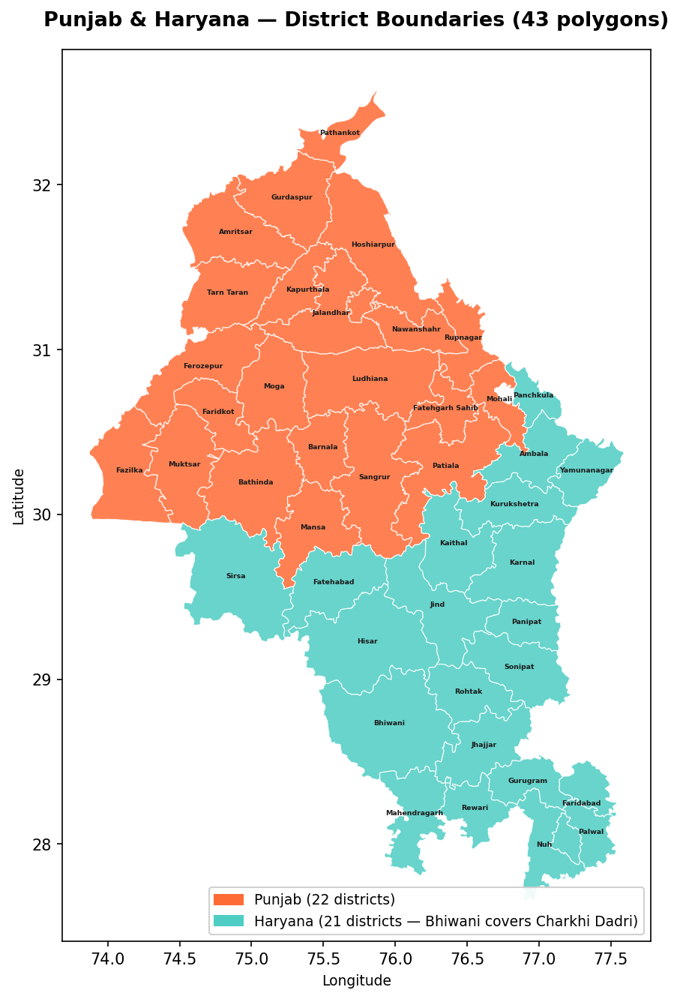](https://github.com/dhruv-soni-agritech/agroflame-residue-mapper/blob/main/assets/study_area_districts.png)

## Objectives

- Quantify historical and current crop-residue burning intensity at the district level.
- Convert recoverable residue volume into a projected bioenergy revenue opportunity per district.
- Cluster districts into environmental severity zones using climate and fire data.
- Combine environmental severity and feedstock availability into a ranked list of recommended bioenergy plant sites.
- Serve the results through a public, interactive dashboard for non-technical stakeholders.

## Data Sources

| Source                | Data                                             | Volume                                          |
|-----------------------|--------------------------------------------------|-------------------------------------------------|
| NASA FIRMS (VIIRS)    | Satellite fire detections (NOAA-20 and S-NPP)    | 8,723,785 raw points (2015-2023)                |
| State Govt. / FAOSTAT | Crop production volume (rice and wheat)          | 13 years (Punjab, 2010-11 to 2022-23), 1 year (Haryana, 2022-23) |
| NASA POWER            | Daily temperature, rainfall, humidity, windspeed | 2015-2023, one point per district centroid      |
| ICAR / MNRE           | Residue ratios, heating values, conversion metrics | Lookup parameters                             |
| GADM 4.1              | District administrative shapefiles               | 43 polygons (Punjab and Haryana)                |

### Fire Data Funnel

The fire data is reduced in three documented stages.

| Stage | Notebook | Rows remaining |
|---|---|---|
| Raw VIIRS archive (both satellites) | NB02 | 8,723,785 |
| After bounding box, season filter (April-May and October-November) and confidence filter (>= 30, which removes "low") | NB02 | 1,242,007 |
| After point-in-polygon join to the 43 district polygons | NB03 | 1,179,053 |

- The spatial join drops 62,954 points (5.07%) that fall on borders, water bodies or outside the polygons.
- Of the final points, Kharif (October-November) accounts for 951,422 and Rabi (April-May) for 227,631. By state, Punjab contributes 1,020,759 and Haryana 158,294.

## Methodology — The Three-Module Framework

The pipeline runs across **17 modular Jupyter notebooks** (Python, Pandas, NumPy, GeoPandas, Scikit-learn, pymannkendall), organized into three analytical modules that feed a final decision layer.

### Module A — Urgency: Burning Risk Assessment (BRS, 0-100)

Aggregates the 1,179,053 district-mapped detections into district-by-year statistics (fire count, mean **Fire Radiative Power**, fire days, onset day, peak week) and applies a **Mann-Kendall trend test** with **Sen's slope** to each district's 9-year fire-count series.

**BRS = 0.40 x fire frequency + 0.30 x fire intensity (FRP) + 0.30 x trend slope**, each min-max scaled to 0-100. Negative slopes are clipped to zero so that improvement is not rewarded and only growth adds risk. Districts are classed as Critical (75 and above), High (50-75), Moderate (25-50) or Low.

[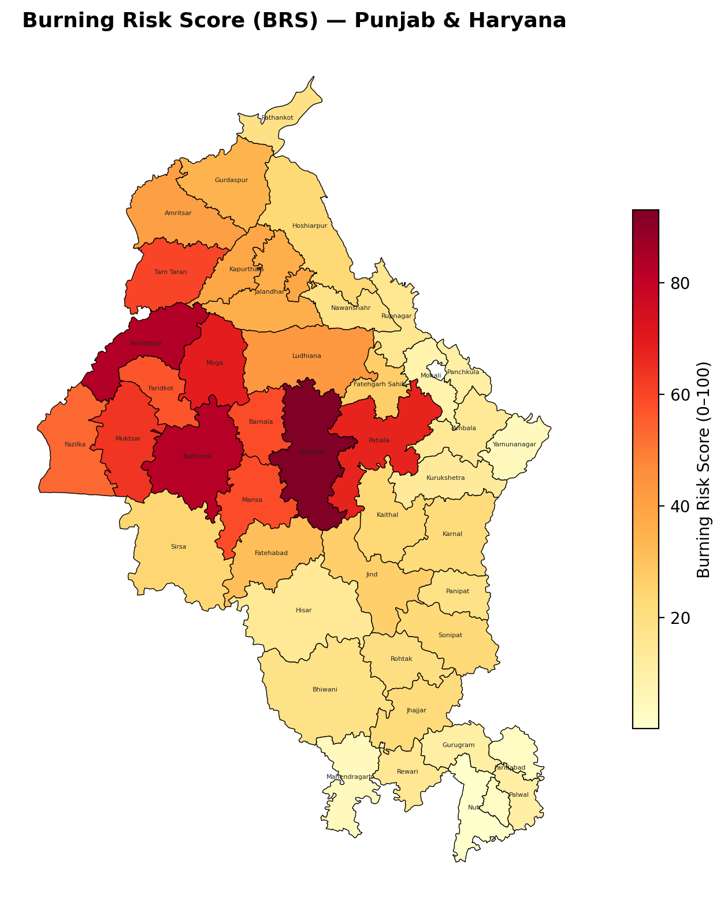](https://github.com/dhruv-soni-agritech/agroflame-residue-mapper/blob/main/assets/brs_continuous_map.png)

[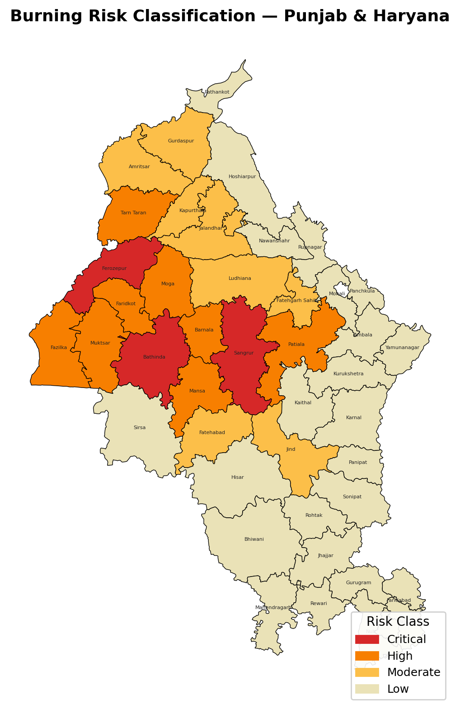](https://github.com/dhruv-soni-agritech/agroflame-residue-mapper/blob/main/assets/brs_classified_map.png)

- Highest urgency: Sangrur (BRS 93.1), followed by Ferozepur (83.5) and Bathinda (82.4). Class split across 43 districts: 3 Critical, 8 High, 8 Moderate, 24 Low.
- Only 2 of 43 districts show a statistically significant trend at p < 0.05: an increasing trend in Faridabad and a decreasing trend in Sirsa. The other 41 show no detectable trend. Because 43 tests are run on only 9 annual points, these two results are indicative rather than conclusive.

### Module B — Opportunity: Bioenergy Potential (BPS, 0-100)

Builds a residue-to-revenue logic tree per district, crop and year:

- **Residue generated** = production x residue-to-product ratio (rice 1.50, wheat 1.10)
- **Recoverable residue** = generated x (1 - burn fraction) x 0.70 collection efficiency, with burn fractions of Punjab rice 0.80, Haryana rice 0.65 and wheat 0.50
- **Energy** = recoverable residue x lower heating value (rice 14.3 GJ/t, wheat 17.5 GJ/t)
- **CBG** = 22 kg per tonne of recoverable residue, valued at the SATAT-preferred price of Rs 46/kg
- **BPS** = district average gross energy potential (GJ), min-max scaled to 0-100

Sangrur scores a perfect BPS of 100, representing an estimated Rs 85.3 Crore/year bioenergy opportunity, followed by Ludhiana (Rs 73.4 Crore) and Karnal (Rs 65.8 Crore).

### Module C — Context: Environmental Severity (BSI, 0-100)

Builds four district features (mean annual fire count, mean recoverable residue, mean temperature, total rainfall), standardizes them, and then:

- Applies **Principal Component Analysis (PCA)** to derive data-driven weights for the **Burning Severity Index (BSI)**. The absolute PC1 loadings, normalized to sum to 1, become the weights (rainfall 0.283, temperature 0.270, fire count 0.229, residue 0.218). Rainfall is inverted because higher rainfall suppresses burning, and the score is scaled to 0-100. PC1 and PC2 explain 53.6% and 33.4% of variance.
- Applies **K-Means clustering** (k = 3) on the standardized features to group districts into three environmental zones. Cluster labels are assigned by ranking each cluster's mean fire count rather than by raw cluster ID, with an automatic check that the highest-fire districts fall in the high-stress zone.

[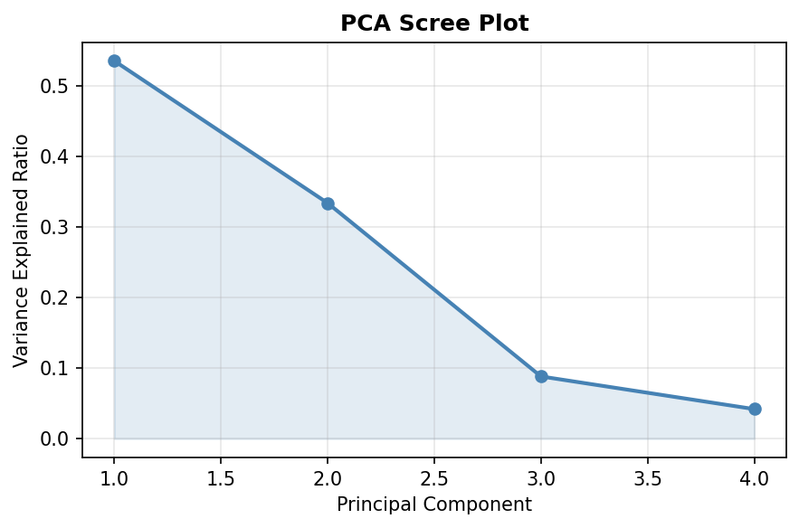](https://github.com/dhruv-soni-agritech/agroflame-residue-mapper/blob/main/assets/pca_scree_plot.png)

[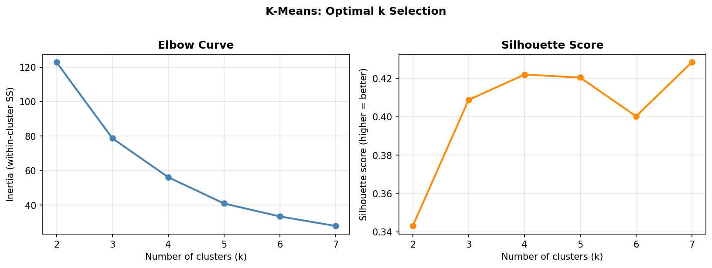](https://github.com/dhruv-soni-agritech/agroflame-residue-mapper/blob/main/assets/kmeans_optimal_k.png)

[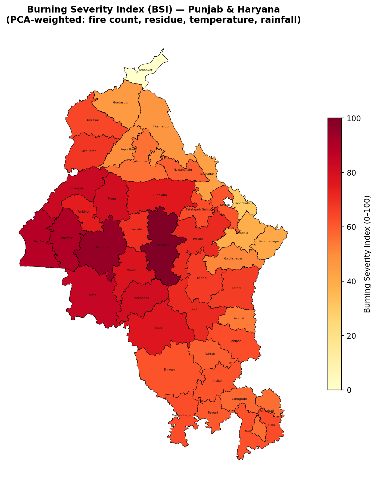](https://github.com/dhruv-soni-agritech/agroflame-residue-mapper/blob/main/assets/bsi_map.png)

[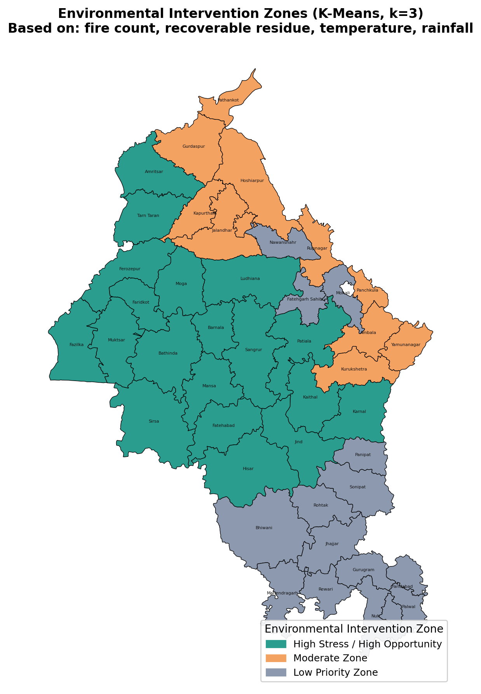](https://github.com/dhruv-soni-agritech/agroflame-residue-mapper/blob/main/assets/intervention_zones_map.png)

- The elbow curve and silhouette score were reviewed for k = 2 to 7. The silhouette peaked at k = 7 (0.428), and k = 3 was chosen deliberately because it maps to three actionable policy tiers (overall silhouette 0.409).
- Top BSI districts: Sangrur (100.0), Bathinda (95.1), Muktsar (90.0), Fazilka (88.5) and Sirsa (84.4).

### Synthesis — The Decision Matrix

The final plant-site map is a transparent two-axis, threshold-based classification of **BSI** and **average recoverable residue**:

- **Plant Zone:** BSI at or above the 70th percentile (71.2) and recoverable residue at or above the 70th percentile (460,304 tonnes per year)
- **Policy Zone:** high BSI but residue below the threshold
- **Low Priority:** everything else

BRS, BPS and the K-Means zones are reported alongside this classification as supporting context and are not inputs to the threshold rule. The result is 9 Plant Zones, 4 Policy Zones and 30 Low Priority districts.

- Plant Zones, Punjab (final): Sangrur, Bathinda, Muktsar, Moga, Ludhiana, Patiala
- Plant Zones, Haryana (preliminary): Sirsa, Fatehabad, Hisar
- Policy Zones: Fazilka, Ferozepur, Mansa, Faridkot

[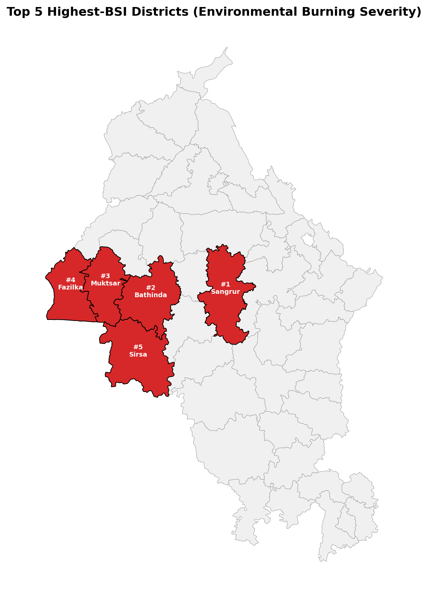](https://github.com/dhruv-soni-agritech/agroflame-residue-mapper/blob/main/assets/top5_bsi_districts.png)

[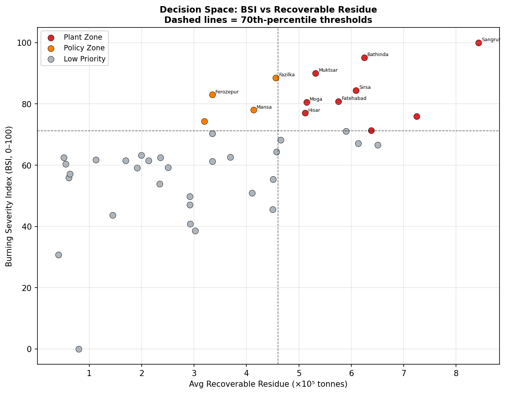](https://github.com/dhruv-soni-agritech/agroflame-residue-mapper/blob/main/assets/decision_space_scatter.png)

[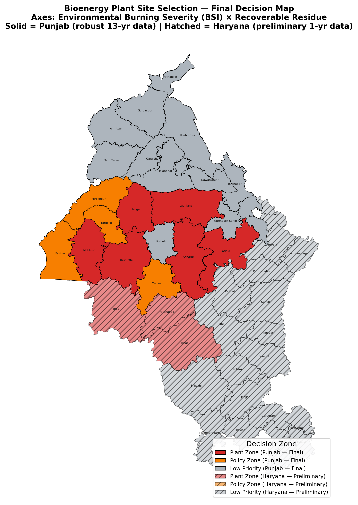](https://github.com/dhruv-soni-agritech/agroflame-residue-mapper/blob/main/assets/final_decision_map.png)

## Model Validation

Cluster stability was tested with **200 rounds of random 80% subsampling** (37 of 47 feature-table rows per round, drawn without replacement). Each round fits a fresh scaler and a new K-Means model, matches cluster labels back to the original clustering with the **Hungarian algorithm**, and records whether each district stayed in its original cluster.

- Mean stability across districts: **98.65%**
- **46 of 47 rows (97.9%)** remained stably classified (stability of 90% or more).
- Only **Hisar** showed borderline behavior (76.5% stability, silhouette -0.076), a genuinely mixed fire/residue profile sitting at a natural cluster boundary, not a modeling error.
- This is a subsampling stability test rather than a classical bootstrap with replacement, and each round is compared against the clustering of the full dataset.

[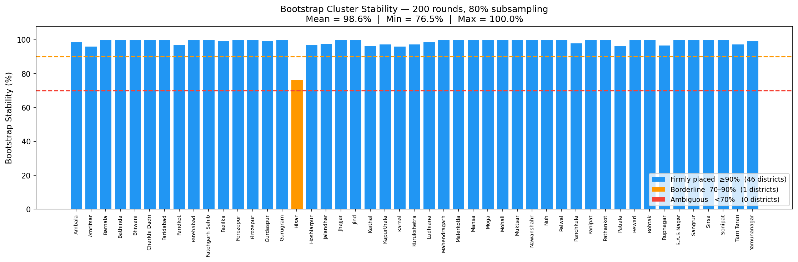](https://github.com/dhruv-soni-agritech/agroflame-residue-mapper/blob/main/assets/bootstrap_stability_barchart.png)

[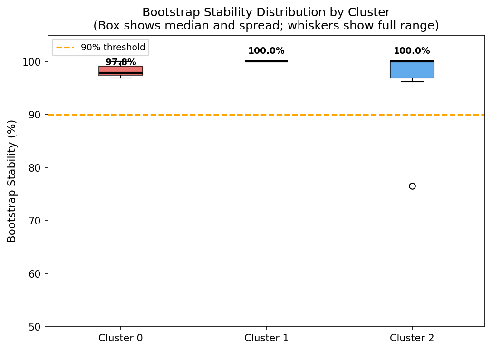](https://github.com/dhruv-soni-agritech/agroflame-residue-mapper/blob/main/assets/bootstrap_stability_by_cluster.png)

[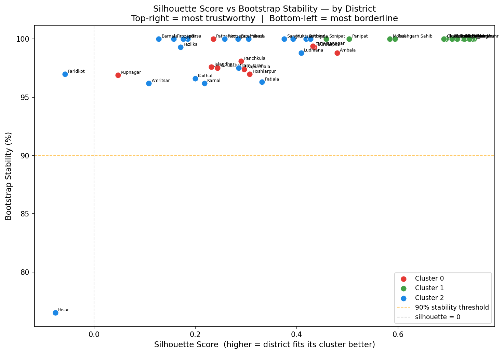](https://github.com/dhruv-soni-agritech/agroflame-residue-mapper/blob/main/assets/stability_vs_silhouette.png)

## Data Reliability and Confidence Index

Punjab and Haryana are scored using an identical methodology but reported with **different confidence tiers**, reflecting real differences in data depth.

| Attribute             | Punjab                             | Haryana                   |
|-----------------------|------------------------------------|---------------------------|
| Crop data depth       | 13 years (robust, multi-season)    | 1 year (2022-23, limited) |
| Confidence level      | High / Final                       | Preliminary               |
| Recommended next step | Immediate site feasibility studies | Multi-year validation     |
| Plant Zone districts  | Sangrur, Bathinda, Muktsar, Moga, Ludhiana, Patiala | Sirsa, Fatehabad, Hisar |

This distinction was a deliberate design choice — the project avoids overstating certainty in regions where the underlying data doesn't yet support it. Haryana districts are shown with hatched fills on the decision map.

## Design Evolution from the Proposal

The original proposal (see `PROPOSAL.md`) planned a Composite Action Priority Score combining burning risk, bioenergy potential and a farmer **Participation Viability Index** built from socioeconomic data, along with an XGBoost model and a Folium-based interface. District-level socioeconomic data of sufficient quality was not available for the full study area, so Module C was redesigned around environmental data and the final decision layer became a transparent two-axis rule. As a result, a Plant Zone label means environmentally urgent and feedstock-rich, which is necessary but not sufficient for plant viability, because farmer participation is not modeled.

## Known Limitations and Data Notes

- **Fire detections are a proxy, not burned area.** A VIIRS detection is a thermal anomaly, overpass timing can miss afternoon burning, and some detections may not be agricultural. Fire count is used as a relative indicator across districts.
- **BRS weights are judgement-based.** The 40/30/30 weighting follows standard multi-criteria practice and has not been sensitivity-tested.
- **BSI and the decision rule share inputs.** Fire count and residue enter both the BSI and the decision thresholds, so the two axes are not fully independent.
- **Climate features are period-wide.** Temperature is the mean over all days from 2015 to 2023 and rainfall is the 9-year total, not burning-season values, sampled from coarse MERRA-2 grid cells at district centroids.
- **Residue parameters are literature-based state-level constants** (residue ratios, burn fractions, collection efficiency, CBG yield, price). Recoverable residue counts the unburned share of straw, so it is a conservative feedstock estimate.
- **District naming variants.** GADM 4.1 predates some administrative changes (Charkhi Dadri is absorbed into Bhiwani, and newer districts such as Malerkotla have no polygon), and a few districts are spelled differently across sources (for example Ferozepur / Firozepur and Mohali / S.A.S Nagar). The 43 polygons are therefore matched to a 47-row feature table with median imputation for unmatched values. Results for affected districts, most notably Ferozepur, should be re-verified after name harmonization.
- **Single-year Haryana crop data** limits all Haryana residue and bioenergy figures to preliminary status.

## Dashboard

An interactive **Streamlit** dashboard exposes district-level scores, trend maps, and the final decision matrix to non-technical stakeholders (policymakers, investors). It is organized into four tabs and driven by a district selector in the sidebar, with KPI cards, fire-trend charts, ranked revenue views and pre-rendered maps.

## Repository Structure

```
AgroFlame/
├── Docs/                  # Project report
├── Notebooks/             # NB01-NB17: end-to-end pipeline (ingestion, ML, validation)
├── Outputs/               # Maps, charts and the final decision table
├── assets/                # Result maps and charts (referenced in this README)
├── data/                  # Raw and processed datasets (FIRMS, crop stats, climate)
├── PROPOSAL.md            # Original project proposal
├── README.md
├── main.py                # Streamlit dashboard
└── requirements.txt       # Python dependencies
```

## Notebook Guide

| Notebook | Purpose |
|---|---|
| 01_setup_spatial | Load GADM, filter to Punjab and Haryana, fix district names |
| 02_fire_processing | Merge VIIRS files; filter by bounding box, season and confidence |
| 03_spatial_join | Point-in-polygon join of fire points to districts |
| 04_fire_aggregation | District-by-year fire count, mean FRP, fire days, onset, peak week |
| 05_trend_analysis | Mann-Kendall test and Sen's slope per district |
| 06_burning_risk_score | Weighted BRS and risk classes |
| 07_burning_risk_map | Continuous and classified BRS maps |
| 08_crop_clean | Clean Punjab and Haryana crop statistics |
| 09_residue_calc | Residue generated, burned and recoverable |
| 10_bioenergy_calc | Energy potential, CBG volume, revenue and BPS |
| 11_env_feature_engineering | Merge fire, residue and climate features |
| 12_env_scaling | StandardScaler on environmental features |
| 13_kmeans_clustering | Elbow and silhouette analysis, K-Means (k = 3), data-driven zone labels |
| 14_pca_bsi | PCA and PC1-weighted Burning Severity Index |
| 15_maps_visualization | BSI, zone and top-5 maps with a consistency check |
| 16_final_decision_map_improved | Plant / Policy / Low Priority decision and reliability tiers |
| 17_Bootstrap | 200-round cluster stability test |

## Tech Stack

**Python** (Pandas, NumPy, GeoPandas, Scikit-learn) across 17 Jupyter notebooks for the end-to-end pipeline. **Mann-Kendall trend test** (pymannkendall) for burning trajectory detection. **PCA** for BSI weighting and **K-Means clustering** for environmental severity zoning, validated with elbow curve, silhouette score, and 200-round subsampling stability testing. **Streamlit** and **Plotly** for the public-facing interactive dashboard.

## Future Scope

- Extend multi-year crop data coverage to Haryana to upgrade its confidence tier.
- Harmonize district names across all sources and replace median imputation with true values.
- Add a sensitivity analysis on BRS weights and residue parameters.
- Integrate real-time VIIRS feeds for live fire-season monitoring.
- Add site-level feasibility scoring for the recommended plant-zone districts.

## Team

Dhruv S. Soni, Mehul B. Chaudhary, Yash D. Daslaniya, Maharshi K. Patel, Tushar J. Vadodariya, Gopal Patidar

Submitted to: Mr. Prasun Kumar Gupta

## License

This project is licensed under the MIT License — see LICENSE for details.
